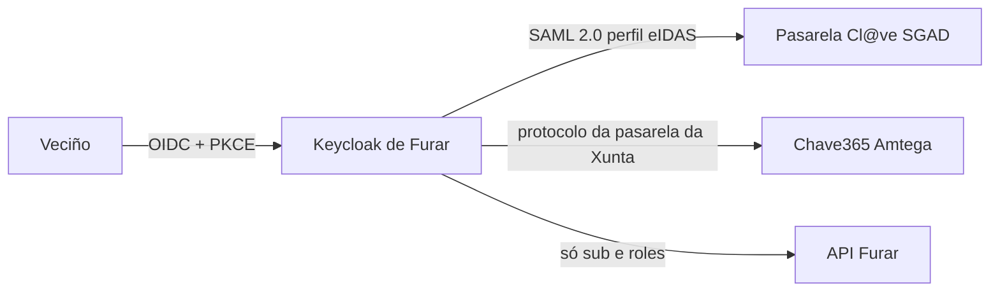

<!--
SPDX-FileCopyrightText: 2026 Santiago Herrero Padín e colaboradores de Furar
SPDX-License-Identifier: CC0-1.0
-->

# ADR-0007 · Seguridade pechada por defecto; Keycloak autentica, os casos de uso autorizan

- **Estado:** aceptada · 2026-10-22 (revisada tras a revisión do equipo); revisada o 2026-10-26, o 2026-10-28 (dúas veces), o 2026-10-29, o 2026-11-02 (dúas veces), o 2026-11-03 e o 2026-11-04
- **Revisada 2026-10-26 (dominio 2, [ADR-0025](0025-reservas-fase-1.md)):** `@PersonUseCase` e persoa sen rol.
- **Revisada 2026-10-28 (dominio 4, plan §1.2.10):** `PLATFORM_ADMIN` só cos permisos que o nomean; `auth.email-not-verified`.
- **Revisada 2026-10-28 (dominio 4, [ADR-0027](0027-persoal-e-permisos-fase-1.md)):** roles de concello desde `staff_member` e dobre factor por autenticación escalonada.
- **Revisada 2026-10-29 (revisión de seguridade do dominio 4):** regra do segundo factor con `acr`, validación de `azp` e orde do fluxo `furar-browser`.
- **Revisada 2026-11-02 (decisión do mantedor):** sen segundo factor para ninguén. Fóra a autenticación escalonada (`acr_values=furar-2fa`, `acr` e `amr` na API, 403 `auth.step-up-required`), o fluxo `furar-browser` con niveis, o rol `furar-2fa`, o OTP e os códigos de recuperación; o realm usa o fluxo `browser` da base, en produción e na demo. Quen perde o acceso ao seu correo: a xestión desactívao e invita o correo novo. A medida do ENS que deixa de cumprirse, en [ens.md](../ens.md) (op.acc.6).
- **Revisada 2026-11-02 (decisión do mantedor, [ADR-0027](0027-persoal-e-permisos-fase-1.md)):** Keycloak confía nunha proba asinada pola API para dar por verificado o correo de quen se rexistra desde a invitación do persoal, e o contrasinal pídese no formulario de rexistro.

- **Revisada 2026-11-03 (decisión do mantedor, [ADR-0028](0028-administracion-da-plataforma-e-primeiro-acceso.md)):** `PLATFORM_ADMIN` xa non vén do token (grupo `plataforma`, claim `furar_roles`): sae da táboa `platform_admin` en cada petición, e a primeira administración é a conta co correo verificado de `FURAR_ADMIN_EMAIL`. Keycloak non dá ningún rol.
- **Revisada 2026-11-04 (decisión do mantedor, maqueta 55):** os correos de Keycloak con ligazón de acción levan baixo o botón unha ligazón curta (`/auth/realms/furar/l/XXXX-XXXX-XXXX`) no canto do URL longo. A extensión de Furar garda o URL baixo un código de 12 caracteres de `SecureRandom` (~59 bits) no almacén de obxectos dun só uso de Keycloak, coa mesma vida ca a acción, e o recurso do realm redirixe (302) ou, se non existe, mostra a páxina de erro do tema. Non dá acceso por si: só leva ao URL da acción, que segue asinado e caduca igual; cos bits e a vida curta, adiviñar un código non é viable sen límite de intentos, e os códigos non se rexistran. Pasa polo Caddy coma o resto de `/auth/realms/*` (non é administración).
## Contexto
Un erro habitual é deixar todo aberto (`permitAll`) e facer un JWT propio. As bases piden RGPD e «mecanismo de autenticación pública previsto» (Cl@ve, Chave365). Obxectivo: ENS nivel medio en produción; mapa de medidas e pendentes en [ens.md](../ens.md). Un caso de uso pódese chamar desde un controlador, outro módulo ou un evento: o permiso ten que estar no caso de uso, non só na porta HTTP.

## Decisión
**Identidade**
- Keycloak (OIDC) na mesma orixe, baixo `/auth` (`KC_HTTP_RELATIVE_PATH=/auth`, `KC_HOSTNAME=${FURAR_PUBLIC_URL}/auth`, `KC_PROXY_HEADERS=xforwarded`; TLS en Caddy).
- Web: código + PKCE (`oidc-client-ts` 3.5.0, Apache-2.0), cliente fixo `furar-web`, emisor `${location.origin}/auth/realms/furar` (nada de despregue compilado na imaxe). Tokens **en memoria**; ao recargar, se había sesión (marca sen datos en `localStorage`, `furar.session`), `signinRedirect` con `prompt=none` (funciona porque a cookie SSO de Keycloak é de primeira parte). O `state` e o `code_verifier` de PKCE e a páxina de volta van en `sessionStorage`, porque teñen que sobrevivir á redirección; non son tokens. **Rotación do refresh token** no realm (`revokeRefreshToken: true`, `refreshTokenMaxReuse: 0`; RFC 9700 §4.14, SEC2-04): un refresh roubado por un XSS só vale ata a seguinte renovación de quen o tiña, e o seu reuso falla con `invalid_grant`. D48 compróbao. Cl@ve e Chave365 como provedores de identidade SAML de Keycloak: o conector próbase xa na demo cun IdP «Cl@ve simulada» ([ADR-0019](0019-autenticacion-publica-clave.md), D52); a alta da pasarela real, en «Identidade pública» e [`instalacion.md` §12](../instalacion.md#12-clve-e-chave365).

**Validación do JWT (API = resource server)**
- Chaves por `jwk-set-uri` **interno** (`http://keycloak:8082/auth/realms/furar/protocol/openid-connect/certs`; en `dev`, `localhost:8082`), e validador explícito de `iss = ${FURAR_PUBLIC_URL}/auth/realms/furar`, `aud ∋ furar-api`, caducidade e cliente: `azp` ten que ser `furar-web` (`furar.security.clients`; a demo engade `furar-e2e`, que `ProdProfileGuard` non deixa en `prod`), porque `aud=furar-api` podería engadilo outro cliente do realm. Unha soa variable `FURAR_PUBLIC_URL` por perfil (`dev`: `http://localhost:4200`, `full`: `http://localhost:8080`). Non se usa `issuer-uri`: evita que a API dependa de Keycloak para arrincar e o choque entre URL interna e pública. **Caché das chaves:** a por defecto de Spring Security 7.1 sobre Nimbus: `NimbusJwtDecoder.withJwkSetUri` constrúe o `JWKSourceBuilder` con caché de 5 min e apaga a renovación anticipada e o límite de recargas (`refreshAheadCache(false)`, `rateLimited(false)`). Pasados os 5 min, a seguinte petición volve pedir as chaves. Unha chave nova (`kid` descoñecido) forza a recarga, así que a rotación de Keycloak non corta sesións. Retirar unha chave comprometida tarda como moito 5 min en notarse na API, o mesmo que dura un access token (`accessTokenLifespan` 300 s): baixala só multiplicaría as peticións a Keycloak sen pechar antes os tokens xa emitidos. Non se cambia.
- Tests: `TestJwtConfig` cunha clave RSA xerada ao arrincar (`NimbusJwtDecoder.withPublicKey`) e `TestTokens` (`manager("naron")` e `staff("naron")`, que lle dan ao `sub` unha pertenza `ACTIVE` na táboa; `person(…)`, `platformAdmin()`, `otherClient(…)`, `expired()`, `wrongIssuer()`…).

**Porta HTTP pechada**
- `anyRequest().authenticated()`; públicos só os métodos `@PublicEndpoint` (os `RequestMatcher` constrúense ao arrincar), `/healthz` e o OpenAPI público. Actuator vai noutro porto (9081) e só expón `health`.
- Públicos desde o día 1: `GET /municipalities`, `GET /municipalities/{slug}`, `GET …/theme`, `GET …/custom-fields` (só definicións `PUBLIC`).
- 401 e 403 saen en `problem+json` (`ProblemAuthenticationEntryPoint`, `ProblemAccessDeniedHandler`, ADR-0008).

**Permisos no caso de uso**
- `shared.security`: interface `PermissionKey` (código estable e roles que o teñen), porto `CurrentActor` (id, roles por concello) e `RolePermissions`, que **xunta nunha matriz** os `enum` de permisos de cada módulo (`MunicipalityPermission`, `FacilityPermission`, `BookingPermission`, `StaffPermission`…; os transversais `SharedPermission`, `PortabilityPermission` e `AuditPermission`; ARQ3-2). Cada permiso nomea os roles que o teñen, `PLATFORM_ADMIN` incluído: a plataforma non ten nada que non estea escrito. `RolePermissionsTest` fixa a súa fila exacta e que o xestor ten todo o do concello. Un código repetido impide arrincar.
- Cada método público dun `*Service` que implementa un `*UseCase` leva `@RequiresPermission(XPermission.Code.Y)` (o código; unha anotación non admite un tipo interface) ou `@PublicUseCase` ou `@PersonUseCase` (regra A15). Un código sen rexistrar nega sempre e `RolePermissionsTest` rompe o build. Faino cumprir un interceptor de Spring Security (`AuthorizationManagerBeforeMethodInterceptor`) que comproba o permiso **no concello do `TenantContext`**; sen permiso → `AccessDeniedException` → 403 `auth.forbidden`.
- O controlador non repite `@PreAuthorize`: só marca `@PublicEndpoint` cando é público.
- **`@PersonUseCase`:** para o que fai unha persoa sobre o seu (reservar, ver, cambiar e cancelar as súas reservas, aceptar unha invitación). Pide sesión e `email_verified = true` no token, en calquera concello, sen rol; o caso de uso filtra polo `sub` (outra persoa → 404). Sen sesión → 401; co correo sen verificar → 403 `auth.email-not-verified`. Non abre nada do concello: só os datos propios de quen chama.
- Roles: `PLATFORM_ADMIN` (global), `MANAGER` (xestor; na web, «Xestión») e `STAFF` (conserxe; na web, «Recepción»). `PLATFORM_ADMIN` sae da táboa `platform_admin` do módulo `staff` en cada petición (desde o 2026-11-03, [ADR-0028](0028-administracion-da-plataforma-e-primeiro-acceso.md); antes, do claim `furar_roles`, que Keycloak emitía desde o grupo `plataforma`): ningún rol do token dá nada. **Os roles de concello saen da táboa `staff_member` do módulo `staff`, en cada petición e no concello do `TenantContext`** ([ADR-0027](0027-persoal-e-permisos-fase-1.md)): a desactivación e o cambio de rol valen na seguinte petición, e un `slug:MANAGER|STAFF` no claim non dá nada. **A persoa que reserva non ten rol:** a conta é común a todos os concellos ([ADR-0017](0017-datos-persoais.md)) e ninguén recibe un rol ao rexistrarse; os seus casos de uso levan `@PersonUseCase`. (`Role` conserva `RESIDENT`, que ninguén recibe e que non dá ningún permiso.) Ter sesión sen rol nun concello non dá nada nese concello: o realm admite autorrexistro, así que unha conta calquera é «público» (SEC-03).
- **`PLATFORM_ADMIN` só co que o nomea:** `municipality.create`, `municipality.import` (dar de alta un concello, tamén desde un ficheiro furar-export), `staff.view`, `staff.invite`, `staff.manage`, `staff.deactivate` e `audit.platform-view`. Non ten reservas, instalacións, campos personalizados, datos nin exportación do concello, nin indicadores, nin `staff-data.view` (para a plataforma, a audiencia dos campos personalizados é `PUBLIC`). Motivos: mínimo privilexio (ENS op.acc.4, segregación de funcións; op.acc.3, a administración da instalación non é a xestión do concello) e a especificación, bloque 7: a administración da plataforma «non ve reservas nin datos da veciñanza». A exportación leva datos da veciñanza, polo que só a fai a xestión do propio concello. **Revisión do 2026-11-03** ([ADR-0028](0028-administracion-da-plataforma-e-primeiro-acceso.md) punto 9): a plataforma recupera a configuración do concello (`municipality.update`, `facility.*`, `customfields.manage`, `audit.view`; na configuración ve os campos coma o persoal), para que quen instala deixe o concello listo; segue sen reservas, indicadores, `staff-data.view`, exportación nin os bloqueados do rexistro.
- **Ámbito dos roles** (`RoleGrant`): `*` só vale para os roles globais (`*:PLATFORM_ADMIN`) e un rol global só vale con `*`. `*:MANAGER` ou `naron:PLATFORM_ADMIN` non valen nunca (SEC-04): un erro ao crear roles en Keycloak non pode dar xestión de todos os concellos. `RolePermissionsTest` próbao para cada rol.

**Tests:** `EndpointSecurityIT` percorre todos os handlers (comproba que son ≥ N e coinciden coas operacións de `openapi.json`): sen token → 401 salvo `@PublicEndpoint`. `CrossTenantAuthorizationIT`: o MANAGER de A en cada escritura de B → 403. `JwtValidationIT`: outro `iss`, sen `aud` ou caducado → 401. `RolePermissionsTest` xera os casos desde a matriz.

**Cabeceiras (Caddy, fóra de `/auth/*` e `/api/*`):** `default-src 'self'`; `script-src 'self'` + hashes de `security.autoCsp` de Angular; `style-src 'self'` (sen `unsafe-inline`: o tema por concello e os `[style.*]` van por CSSOM, `setProperty`, que a CSP non bloquea; ningún compoñente ten estilos propios e ESLint prohíbe `styles`/`styleUrl`, porque Angular os inxectaría como `<style>`; `inlineCritical: false`); `img-src 'self' data:`; `frame-ancestors 'none'`; HSTS, `X-Content-Type-Options`, `Referrer-Policy`, `Permissions-Policy`. En `/auth/*` mándase a CSP de Keycloak. CORS pechado (mesma orixe).

**Administración, dobre factor e rexistro (Keycloak e Caddy, AP-04, SEC-01, SEC-05)**
- **Consola de administración pechada en produción.** Caddy responde 403 en `/auth/admin*` e `/auth/realms/master*` (onde inicia sesión o administrador e está `admin-cli`) salvo desde `FURAR_ADMIN_IPS`, que `compose.prod.yaml` fai obrigatorio; o recomendado é `127.0.0.1/32` (pechado) e administrar por túnel SSH a `127.0.0.1:8082` (`KC_HOSTNAME_ADMIN`). En local, por defecto só redes privadas, pero o perfil `full` só escoita en `127.0.0.1` (SEC3-01, ADR-0015). Non se usan rangos de Docker (`172.16.0.0/12`): por IPv6 o proxy de Docker entrega as conexións coa IP da ponte. Próbano X08 (Caddyfile) e D48 (produción).
- **Sen segundo factor (desde o 2026-11-02, decisión do mantedor).** Todas as contas entran co correo e o contrasinal, polo fluxo `browser` da base de Keycloak (o mesmo en produción e na demo). As accións `CONFIGURE_TOTP` e `CONFIGURE_RECOVERY_AUTHN_CODES` van desactivadas, e tamén as WebAuthn; `furar-web` non ten o ámbito `offline_access` (sen tokens offline). A API non mira `acr` nin `amr`: o rol da plataforma sae da táboa `platform_admin` e o de concello da táboa `staff_member` ([ADR-0028](0028-administracion-da-plataforma-e-primeiro-acceso.md)). Contrasinal de 12 caracteres ou máis, distinto do correo e fóra dunha lista de contrasinais comúns, e bloqueo temporal tras 5 fallos ([ens.md](../ens.md#contrasinais-e-bloqueo)). `scripts/comprobar-realm.sh` compróbao nos realms do repo (X02) e nunha instalación en marcha (`--vivo`): sen `furar-2fa` nin niveis, sen as accións do segundo factor, e falla se `furar-api` ten un rol por concello. Ata o 2026-11-02 había dobre factor por autenticación escalonada: nivel 2 de Keycloak (OTP ou código de recuperación) para o persoal, OTP en cada acceso para a plataforma, e a API con `furar.security.require-otp` respondía 403 `auth.step-up-required` se faltaba; D48 probábao cun Keycloak real. Probas de agora: `JwtValidationIT` (tokens fabricados) e D48 contra un Keycloak real (accesos con contrasinal, alta de concello 201 e exportación 403 `auth.forbidden` para a plataforma, invitación aceptada, e tras a desactivación o mesmo token recibe 403 na seguinte petición).
- **Correo verificado pola invitación (desde o 2026-11-02, [ADR-0027](0027-persoal-e-permisos-fase-1.md) punto 6).** A API e Keycloak comparten un segredo, `FURAR_INVITATION_PROOF_SECRET`, e nada máis: a API non ten credenciais de administración de Keycloak. A API asina (HMAC-SHA256) unha proba curta co correo e a invitación, que só recibe quen ten o token da ligazón do correo; a extensión de Furar no rexistro de Keycloak verifícaa (firma en tempo constante, caducidade de 30 minutos como moito, mesmo correo, un só uso) e marca o correo verificado. Quen tivese o segredo podería verificar calquera correo ao rexistrarse: por iso é aleatorio, de 32 caracteres ou máis, obrigatorio en `compose.prod.yaml`, a API négase a arrincar en `prod` cun de demo ou curto, e non sae nunca nin en rexistros nin en respostas. **Contrasinal no rexistro:** co correo verificado no realm, Keycloak pedía o contrasinal despois da ligazón de verificación, para que ninguén deixase unha conta allea co seu contrasinal; agora pídese no formulario (`always_set_password_on_register_form`, opción que Keycloak marca como obsoleta). Unha conta sen verificar non entra ata verificar o correo, e quen ten o correo recupéraa con «Esqueciches o contrasinal?»; se Keycloak retira a opción, D51 falla.
- **Rexistro de actividade:** eventos de usuario e de administración activados no realm, gardados 90 días (`eventsExpiration`, `adminEventsExpiration`), sen o corpo das peticións de administración (datos persoais). Na API, as accións sensibles (exportar e importar un concello, as do persoal e os seus accesos) quedan na táboa `audit_event`, só engadir e ler para `furar_app` ([ADR-0020](0020-rexistro-de-actividade.md)).
- **Corpo máximo:** Caddy corta en 256 KB os corpos de `/api/*` (413) antes de que Spring os deserialice; o permiso compróbase no caso de uso, despois. Única excepción, 50 MB: `POST /api/v1/municipality-imports` (o ficheiro furar-export dun concello, ADR-0018), só da plataforma; Spring Security rexeita sen token antes de ler o corpo (SEC3-03, X08). Límite de taxa: Caddy oficial non o trae (precisa o módulo `caddy-ratelimit` e unha imaxe propia); Keycloak xa ten protección de forza bruta. Queda pendente (`docs/ens.md`).

**Segredos:** variables de contorno; `compose.prod.yaml` esíxeos (`${VAR:?}`) e a API co perfil `prod` non arrinca se detecta credenciais de demo (`ProdProfileGuardIT`). Datos persoais: ADR-0011.

### Identidade pública (AP-11, AP2-03)

- **Cl@ve:** SAML 2.0 co perfil eIDAS da pasarela (extensións `RequestedAttributes` e nivel de garantía, sinatura das peticións co certificado do organismo). O provedor SAML de Keycloak cobre o protocolo; as extensións eIDAS fan falta nunha extensión pequena de Keycloak (SPI de *identity provider*) ou nunha pasarela intermedia libre. Decídese cando haxa acceso ao contorno de probas.
- **Chave365:** pola pasarela de identificación da Xunta; o protocolo e o alta confírmanse coa Amtega.
- **Quen asina a adhesión:** o organismo que presta o servizo. Nun despregue dun concello, o concello; nun da Deputación para varios concellos, a Deputación (unha adhesión e un certificado para todos). Va con [`docs/datos-persoais.md`](../datos-persoais.md).
- **Minimización:** pídese o nome e o NIF só se un trámite o esixe (taxas con bonificación por empadroamento). O NIF queda en Keycloak como atributo da conta, non nas táboas de Furar, e non vai no token da API: a API só recibe `sub` e roles. A ligazón dunha conta existente cunha de Cl@ve faise por NIF despois de iniciar sesión nas dúas (Keycloak *first broker login*), nunca automaticamente.
- **Feito:** conta local de Keycloak con correo verificado e, na demo, entrada por «Cl@ve simulada» (SAML 2.0 con sinatura validada, NIF non importado; [ADR-0019](0019-autenticacion-publica-clave.md)). O que falta para a pasarela real é a adhesión, o certificado e, para Cl@ve, as extensións eIDAS.

## Consecuencias
- Un endpoint ou caso de uso novo nace pechado: abrilo é unha decisión visible no PR.
- A matriz de permisos é un ficheiro que o xurado e un concello poden ler.
- Keycloak consome ~600 MB; entra no orzamento (ADR-0015).
- Sen segundo factor, un contrasinal roubado abre a conta (risco aceptado polo mantedor, [ens.md](../ens.md)); a lista de contrasinais comúns, o bloqueo temporal e a desactivación na seguinte petición acoutano.

## Alternativas descartadas
- **`@PreAuthorize("@access…")` nos controladores** (deseño inicial): deixa sen control as chamadas desde outros módulos ou eventos e reparte SpEL sen matriz probable.
- **`issuer-uri`:** a API depende de Keycloak para arrincar e falla se a URL interna non coincide coa pública.
- **JWT propio:** reinventar rotación, revogación e federación con Cl@ve.
- **Sesión con cookie (BFF):** engade un servizo; a CSP e os tokens en memoria mitigan XSS.
- **`style-src 'unsafe-inline'`** (decisión inicial, retirada en SEC-10): só facía falta para estilos de compoñente, que non usamos; abría a porta á exfiltración por CSS inxectado. Se algún día fai falta CDK Overlay ou Material (inxectan `<style>`), a saída é `ngCspNonce` con nonce por petición, non volver a `unsafe-inline`.
- **`RESIDENT` implícito no concello do URL para reservar:** rompería `Audiences.forMunicipality` (SEC-03) e mesturaría «ter conta» con «ter un rol no concello»; `@PersonUseCase` dá o mesmo sen rol.
- **Roles só en Keycloak:** o concello non os xestionaría desde Furar.
- **Roles de concello en Keycloak, compostos con `furar-2fa` e cos grupos `persoal` como reforzo** (decisión inicial, retirada o 2026-10-28): a baixa non valía ata que caducaba a sesión, cada concello obrigaba a crear roles na consola e o dobre factor dependía de crealos ben. Keycloak só autentica e dá o nivel 2; o rol sae da táboa ([ADR-0027](0027-persoal-e-permisos-fase-1.md)).
- **Reautenticar con `prompt=login` cando falta o segundo factor** (decisión inicial, retirada o 2026-10-28): volvía pedir o contrasinal e non pedía un nivel concreto.
- **`booking.email-not-verified`:** o correo verificado non o pide só reservar (tamén aceptar unha invitación); por iso o erro é `auth.email-not-verified`.
- **`PLATFORM_ADMIN` con todos os permisos** (decisión inicial, retirada o 2026-10-28): daba á conta da instalación, que ningún concello controla, as reservas, os nomes e os correos da veciñanza de todos os concellos. Tampouco abondaba con quitarlle só reservas, indicadores e datos internos: as instalacións e a exportación son traballo e datos do concello.
- **Dobre factor por autenticación escalonada para o persoal e OTP en cada acceso para a plataforma** (decisión do 2026-10-28, retirada o 2026-11-02 polo mantedor): a xestión pedía o nivel 2 e a API esixía `acr` `furar-2fa` ou `amr` con `otp` ou `mfa` (403 `auth.step-up-required`).
- **OTP para todas as contas:** a veciñanza reserva unha pista; o dobre factor sería unha barreira de acceso (accesibilidade e brecha dixital) sen proporción co risco.
- **Consola de Keycloak aberta a Internet filtrada só por IP:** con IPv6 e o proxy de Docker a IP de orixe non é fiable; o túnel SSH non depende diso.
